<p align="center">
  <a href="https://opensci-optics.com/"></a>
</p>

<h1 align="center">OS Optics</h1>

<p align="center">
  <strong>开源 Python 光学设计与物理仿真引擎 —— 为光学工程师、高并行优化与 AI Agent 原生打造。</strong>
</p>

<p align="center">
  <a href="README.md">English</a> · 简体中文
</p>

<p align="center">
  <a href="LICENSE"></a>
  <a href="https://pypi.org/project/os-optics/"></a>
  <a href="https://pypi.org/project/os-optics/"></a>
  <a href="https://github.com/JunLin615/os-optics/stargazers"></a>
  <a href="https://opensci-optics.com/"></a>
</p>

<p align="center">
  <a href="#快速开始">快速开始</a> ·
  <a href="#为什么选择-os-optics">为什么选择我们</a> ·
  <a href="#视觉画廊">效果展示</a> ·
  <a href="#核心能力">核心能力</a> ·
  <a href="#科学计算生态联用interop">第三方库联用</a> ·
  <a href="#双仓生态os-optics--os-optics-kit">双仓生态</a> ·
  <a href="#参与贡献与路线图">路线图</a>
</p>

<p align="center">
  <picture>
    <source media="(prefers-color-scheme: dark)" srcset="docs/images/hero-dual-dark.png">
    <source media="(prefers-color-scheme: light)" srcset="docs/images/hero-dual-light.png">
    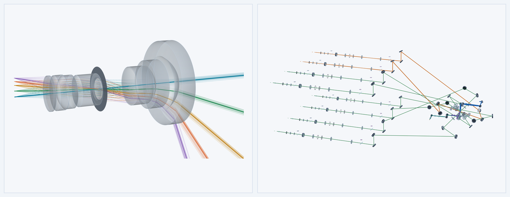
  </picture>
  <br>
  <sub><b>一套引擎，两大场景：</b>精密多片成像镜头处方（左）与百元件级三维自由空间量子光学平台（右）。</sub>
</p>

**OS Optics**（`os-optics`）是一款采用 **MIT 协议开源**的确定性、本地优先 Python 光学设计与物理仿真引擎。你可以在本机搭建多片成像镜头、折返望远系统或百元件级自由空间光路，完成三维光线追迹、高斯光束传播、偏振与干涉、PSF/MTF 像质分析、鬼像与谐振腔计算，并通过标准数据契约与衍射光学、量子光子学和优化科学库无缝联动——既支持工程师直接编写 Python/CLI 脚本，也原生适配 **DeepSeek Harness、Claude Code、Codex、Cursor、WorkBuddy** 等编程智能体与多智能体工作流。

```bash
python -m pip install os-optics
```

| 名称 | 位置 | 定位与内容 |
| --- | --- | --- |
| [`os-optics`](https://pypi.org/project/os-optics/) | PyPI | MIT 开源光学引擎：元件目录、物理仿真、结构化科学结果与 3D 视图 |
| [`os-optics-kit`](https://pypi.org/project/os-optics-kit/) | PyPI | 社区工具箱：18 个可复现光学案例、Agent 技能、高并行扫描/公差分析、实时查看器与绘图 |
| [`os-optics`](https://github.com/JunLin615/os-optics) | GitHub | 本仓库：引擎源代码（`src/os_optics`）、测试套件、文档与公开路线图 |
| [`os-optics-kit`](https://github.com/JunLin615/os-optics-kit) | GitHub | 社区生态仓：完整案例库、跨宿主 Agent Skills、工作流与社区贡献 |

## 为什么选择 OS Optics

光学工具长期面临两难：商业软件封闭昂贵、受限于 GUI 和席位锁；传统开源脚本缺少真实元件数据与严谨的物理有效界限。**OS Optics** 从底层专为**可复现光学工程、高并行计算、跨学科科学库联用与多智能体群（Agent Swarm）工作流**设计：

- **原生高并行，天然契合多智能体群（Agent Swarm）工作流** —— 计算核心完全无状态、无 I/O、无全局锁、无 GUI 或许可证席位限制。你可以同时拉起数十个工作进程、容器或**多智能体群**，并行探索多种镜头拓扑、材料组合与参数分支，通过统一的规范 JSON、确定性退出码与 SHA-256 结果哈希客观对比并快速收敛最优方案。
- **内置跨学科联用契约，无缝融入 Python 衍射、量子与优化生态** —— 核心保持极轻依赖，同时通过内置的 `os-optics interop` 标准契约充当科学计算中枢：横截面光束交接直连 **LightPipes / prysm / POPPY / Diffractio** 衍射传播；含损耗与逐路径群延迟的线性光学网络直连 **Perceval / Piquasso / QuTiP** 量子光子学与冷原子模拟；表格化虚拟元件支持 **grcwa / meent** 超表面；优化与公差无缝对接 **SciPy / Optuna / SALib**。
- **确定性物理 + 诚实数值依据（`value_basis`）** —— 每个数值都标明它是模型值（`MODEL`）、严格证明的上下界（`LOWER_BOUND` / `UPPER_BOUND`），还是超限估计值（`ESTIMATE`）。超出模型范围的目标会明确标记为 `INDETERMINATE`，绝不把近似结果伪装成 `PASS`。
- **真实元件目录 + 自由定制处方** —— 一键同步 3,000+ 款离线版本化光学元件目录（`OS-OPT-*`），同时在同一引擎中支持自定义透镜、偶次非球面、自由曲面（Zernike / XY 多项式 / 双锥面）、双折射晶体和 CSV 镜头处方导入。
- **Agent 原生 CLI 与内存级高速评估会话** —— 全部命令使用结构化 JSON 与自描述 Schema（`os-optics capabilities`、`os-optics schema`）；提供选择性内存评估接口（`os-optics project evaluate` / `EvaluationSession`），在设计迭代与优化循环中自动复用已编译元件与目录数据。
- **极轻纯 Python 内核** —— 仅依赖 `numpy`、`scipy`、`pydantic`、`shapely`，支持 Windows / macOS / Linux（Python 3.11+），无需编译器、GPU、许可证服务器或注册账号。

| 对比维度 | 传统商业光学 GUI | 纯学术 Python 库 | **OS Optics (`os-optics`)** |
| --- | --- | --- | --- |
| 协议与成本 | 闭源昂贵、绑定席位/加密狗 | 开源 | **MIT 开源、免费本地运行** |
| 操作方式 | GUI 为主、宏脚本胶水 | 纯 Python API | **Python API + JSON CLI + 无头/交互 3D 视图** |
| **高并行与多智能体群** | **受席位/GUI 进程限制，并发脆弱** | 临时脚本拼装 | **无状态纯计算核，无限并发，原生适配智能体群并行探索** |
| **第三方科学库联用** | 封闭二进制格式 | 手工胶水转换 | **内置 `interop` 契约：衍射、量子计算、超表面、优化器开箱协同** |
| AI Agent 友好度 | 难以被智能体可靠驱动 | 缺少标准契约 | **JSON Schema、确定性退出码、跨宿主 Skills（`kit`）** |
| 元件数据 | 零散厂商文件 | 多为理想薄镜/手动录参 | **版本化离线目录（3,000+ 元件）+ 自定义物理模型** |
| 模型边界诚实度 | 常静默外推 | 因库而异 | **显式 `value_basis`、功率界限与模型范围诊断** |
| 可复现性 | 二进制工程文件 | 依赖脚本环境 | **规范 JSON 工程 + SHA-256 输入/结果哈希校验** |

## 视觉画廊

每一行以**「左侧光学设计/光路 × 右侧物理/公差分析」**成对呈现，完整覆盖多片成像镜头处方与大型三维自由空间量子光路：

<table>
  <tr>
    <td width="50%" valign="top">
      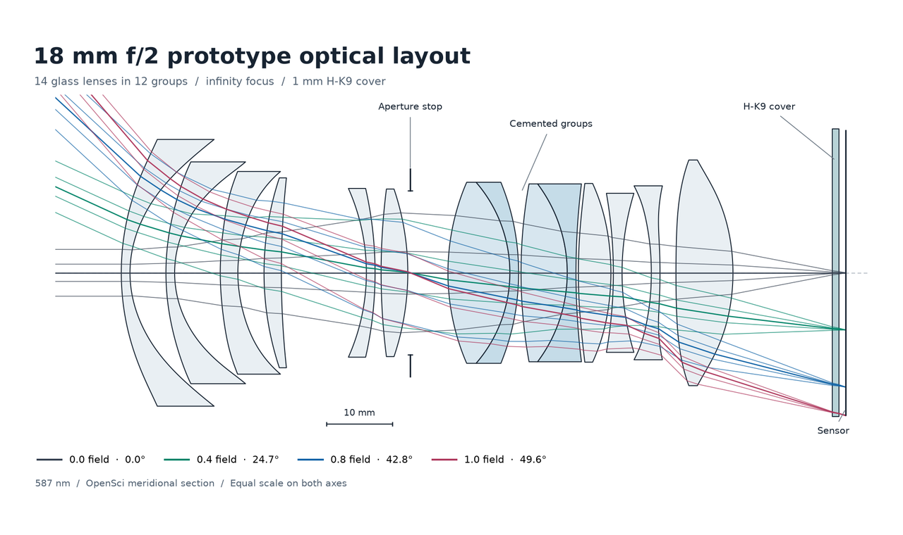
      <br><sub><b>案例 1 · 18 mm f/2 全画幅微单广角（设计）：</b>14 片 12 组宇瞳杯赛题级广角处方，真比例呈现 49.6° 半视场、胶合组与保护玻璃。</sub>
    </td>
    <td width="50%" valign="top">
      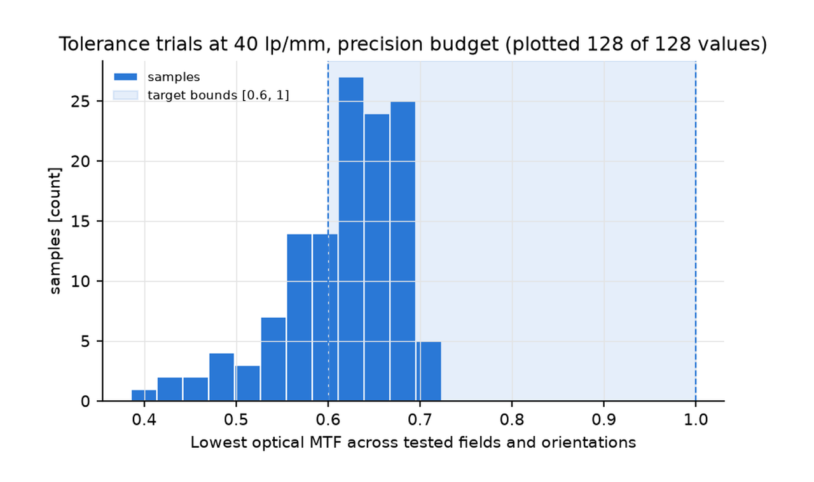
      <br><sub><b>案例 1 · 蒙特卡洛公差分析：</b>128 组随机装调与加工误差下的 40 lp/mm 最低 MTF 统计分布，对照 <code>[0.6, 1.0]</code> 目标区间验证良率。</sub>
    </td>
  </tr>
  <tr>
    <td width="50%" valign="top">
      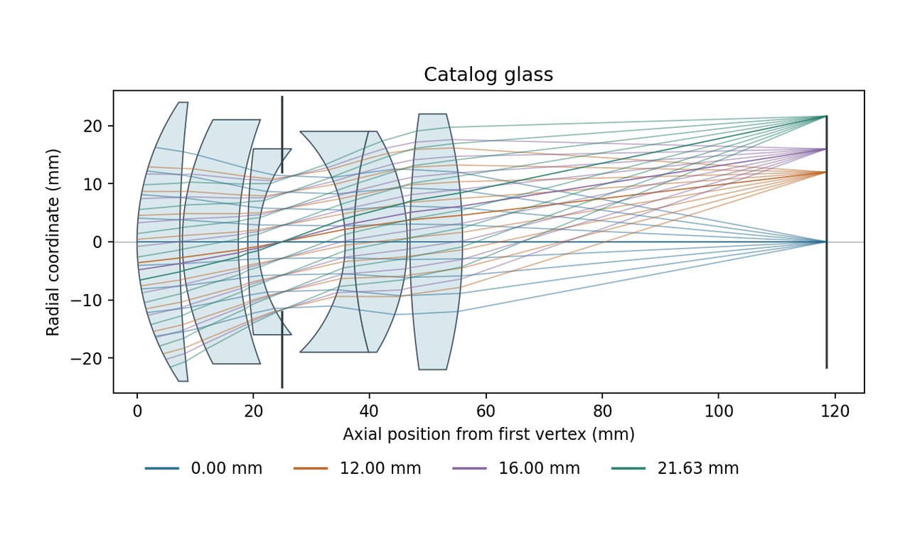
      <br><sub><b>案例 2 · 85 mm 全球面人像镜头（设计）：</b>基于真实商业玻璃目录优化的全画幅子午光路，覆盖轴上至 21.63 mm 边缘像高。</sub>
    </td>
    <td width="50%" valign="top">
      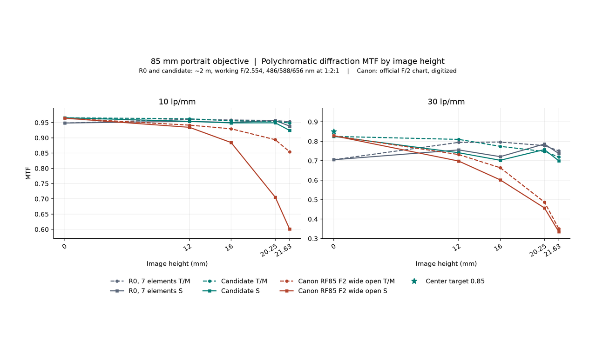
      <br><sub><b>案例 2 · 多波长衍射 MTF 对标：</b>10 与 30 lp/mm 全像高衍射 MTF 曲线，直接对标数字化佳能官方 RF85mm F2 实测基准。</sub>
    </td>
  </tr>
  <tr>
    <td width="50%" valign="top">
      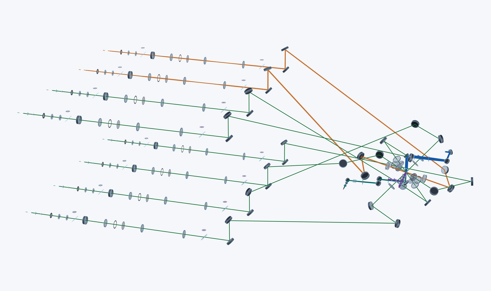
      <br><sub><b>案例 3 · 铷 87 冷原子 3D 量子平台（全局光路）：</b>1.96 m 模块化自由空间工作区，全局布排 160+ 光学实体（MOT、4×4 光镊、里德堡激发与荧光收集）。</sub>
    </td>
    <td width="50%" valign="top">
      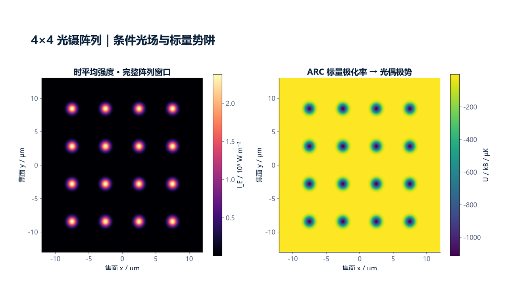
      <br><sub><b>案例 3 · 4×4 光镊光场与原子势阱联算：</b>由引擎导出光场衔接第三方原子物理库（ARC），计算完整阵列焦面强度分布与偶极势阱深度（µK）。</sub>
    </td>
  </tr>
</table>

<details>
<summary>展开更多案例与渲染：半导体 RDL 3D 物镜、三波长衍射 MTF、折返望远系统与镜筒机械包络</summary>
<br>
<table>
  <tr>
    <td width="50%" valign="top">
      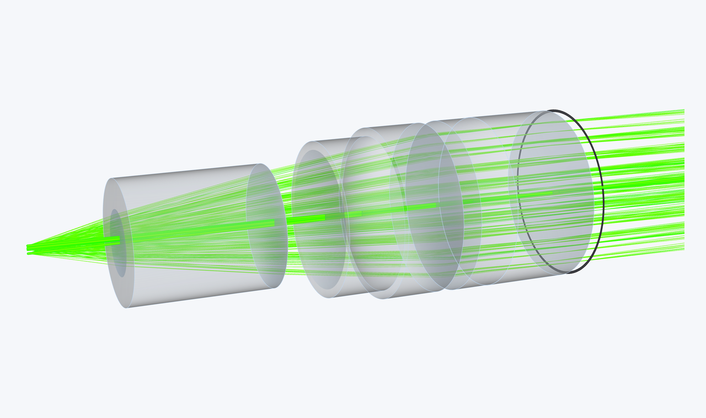
      <br><sub>半导体 RDL 高数值孔径显微检测物镜（3D 演播室玻璃着色）。</sub>
    </td>
    <td width="50%" valign="top">
      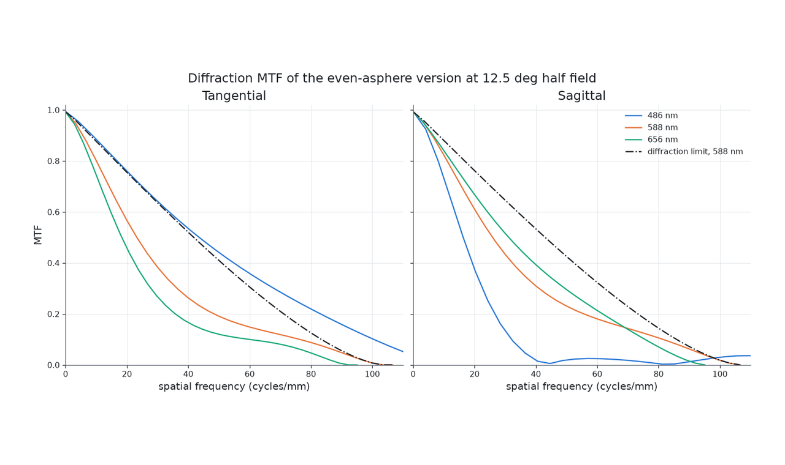
      <br><sub>三波长切向与弧矢衍射 MTF 曲线（含衍射极限参考线）。</sub>
    </td>
  </tr>
  <tr>
    <td width="50%" valign="top">
      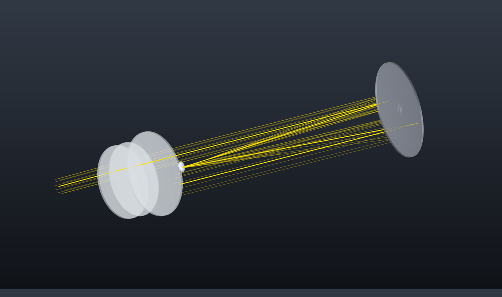
      <br><sub>非序列反射折返式施密特-卡塞格林望远系统。</sub>
    </td>
    <td width="50%" valign="top">
      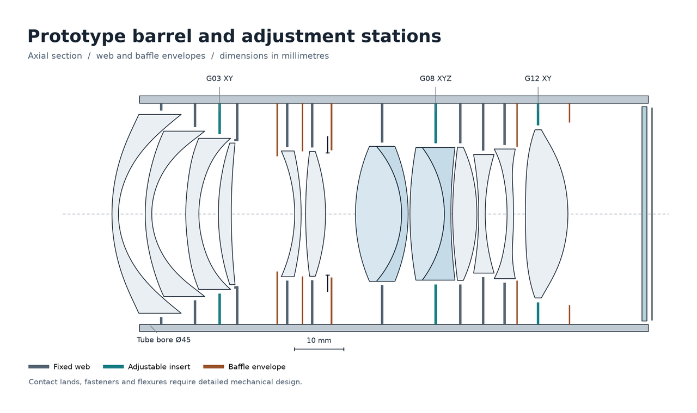
      <br><sub>18 mm f/2 镜筒机械包络与三组主动装调补偿工位。</sub>
    </td>
  </tr>
</table>
</details>

## 快速开始

### 1. 安装引擎

```bash
python -m pip install os-optics
os-optics doctor
```

也可以使用 [uv](https://docs.astral.sh/uv/) 作为独立命令行工具安装：`uv tool install os-optics`。

### 2. 四条命令跑出第一个 3D 光学系统

```bash
os-optics catalog sync
os-optics project example --kind beam_expander > project.json
os-optics project run project.json --out-dir run
os-optics view run
```

依次完成：同步本地离线光学目录 → 生成双透镜扩束示例 → 运行确定性仿真与本地验证 → 在浏览器打开交互式 3D 光路视图。继续以命令行查看和导出科学结果：

```bash
os-optics results describe run
os-optics results targets run
os-optics export arrivals run --format csv --out arrivals.csv
os-optics project verify run
```

### 3. Python API（含高速候选评估会话）

```python
from os_optics.local import EvaluationSession, example_project_of_kind, run_optical_project
from os_optics.results import load_run

project = example_project_of_kind("beam_expander")

# 适合参数优化与并行智能体循环的内存级选择性评估
session = EvaluationSession()
ev = session.evaluate(project, outputs=("readings", "requirements"))
print(ev.requirements())

# 完整运行并写出可校验的结果目录与 3D 场景
run = run_optical_project(project, output_dir="run-python")
results = load_run("run-python")
print(run.status.value, results.power_budget())
```

### 4. 直接交给你的 AI Coding Agent（或智能体群）

将下面这段话发给 **DeepSeek Harness、Claude Code、Codex、Cursor、WorkBuddy** 或任何能运行 Python 的智能体：

> 请从 PyPI 安装 `os-optics` 和 `os-optics-kit`，运行 `os-optics-kit skills list` 查看技能，用真实目录透镜帮我设计一套 532 nm 的 3 倍扩束系统，要求目标面光斑半径小于 50 µm，验证全部目标并给我看 3D 视图。

面向智能体的精简操作入口见 [AGENT_GUIDE.md](AGENT_GUIDE.md)（英文）。

## 核心能力

| 领域 | OS Optics 支持的计算与分析 |
| --- | --- |
| **三维光线追迹与几何** | 非序列 3D 光线追迹；支持平面、球面、二次曲面、偶次非球面、柱面、轴锥镜、Zernike / XY 多项式 / 双锥面 / 环形自由曲面、GRIN 梯度折射率棒、多面体网格、立方分光棱镜、棱镜、楔形板、通孔与透镜阵列。 |
| **材料、膜层与光谱** | 多种色散公式（Sellmeier、Herzberger、幂级数、热光系数 `dn/dT`、实测折射率表），随波长与入射角计算的 s/p 偏振膜层（含相位与群时延界限），多谱线与连续光谱光源。 |
| **高斯光束与偏振** | 像散高斯光束 `q` 参数追迹（束腰、光斑尺寸、发散角、瑞利长度、`M²`）；Jones 与 Stokes 偏振计算，支持部分偏振与非偏振光源、单轴双折射晶体、法拉第旋光器与二次谐波晶体平板。 |
| **干涉、功率与损伤评估** | 完整功率收支账本与严格上下界；双光束干涉（条纹周期、可见度、相干余量）；逐面统计功率、峰值辐照度与脉冲能流，并与元件损伤阈值测试条件逐项核对。 |
| **成像与波动光学分析** | 衍射与几何 PSF / MTF、包围能量、几何波前、四次反射界面鬼像及未枚举鬼像功率上界、相干光场与散斑传播、高数值孔径矢量焦场、线性光学谐振腔、线性光学网络导出。 |
| **高并行、评估与模块化** | 无状态纯计算内核支撑多进程与多智能体群并发探索；`project evaluate` / `EvaluationSession` 选择性评估；多配置并列对比；`workspace` 模块化组合；无头 3D/2D 剖面快照（`--section ALL`）与 SHA-256 可校验运行目录。 |

## 科学计算生态联用（Interop）

`os-optics` 刻意保持极轻核心依赖，并通过内置的版本化交接契约（`os-optics interop list`）充当 Python 光学、衍射与量子生态的**确定性中枢**：

| 跨学科方向 | 联用的第三方科学库 | OS Optics 提供的标准交接契约 | 验证状态 |
| --- | --- | --- | --- |
| **优化与全局灵敏度** | `SciPy`、`Optuna`、`SALib`、`BoTorch` | 无状态 `EvaluationSession` / JSON 运行与可校验结果哈希 | 已端到端验证 |
| **标量衍射与波动光学** | `LightPipes`、`prysm`、`POPPY`、`Diffractio` | `os-optics results handoff`（横截面光束状态、硬光阑轮廓与场构造约定） | 已端到端验证 |
| **量子光子学与冷原子** | `Perceval`、`Piquasso`、`QuTiP`、`NetSquid` | `os-optics project network`（含损耗线性光学传输矩阵 `T[out,in]` 与逐路径群延迟） | 已端到端验证 |
| **超表面与微纳光学** | `grcwa`、`meent`、`torcwa`、`DFlat`、`metabox` | `TABULATED_THIN_LENS` 带已验证波段/视场有效域的虚拟元件 | 已端到端验证 |
| **谐振腔、硅光、薄膜与仪器** | `Finesse 3`、`Meep`、`Tidy3D`、`gdsfactory`、`SAX`、`TorchOptics`、`Chromatix`、`tmm`、`PyMoosh`、`HCIPy`、`MCX`、`PyVISA` | 完整导出接口与物理约定见 [INTEROP.md](docs/engine/INTEROP.md) | 官方指南目录 |

```bash
os-optics interop list
os-optics interop show quantum-photonics
```

## 双仓生态：`os-optics` + `os-optics-kit`

我们刻意将**引擎内核**与**社区工具生态**拆分为两个职责清晰的 MIT 开源仓库：

- **`os-optics`（本仓库）** —— 极轻依赖（`numpy`、`scipy`、`pydantic`、`shapely`），专注物理精度、无状态高并行、确定性回归与稳定 API。
- **[`os-optics-kit`](https://github.com/JunLin615/os-optics-kit)** —— 基于引擎构建的高频生态仓：
  - **18 个引擎可复现光学案例**（85 mm Sonnar、f/3.5 非球面镜头、3–5 µm 中红外成像、扩束系统、偏振控制、Hong-Ou-Mandel 量子干涉、超表面联用、平顶光束整形等）。
  - **18 个跨宿主 Agent Skills**（`os-optics-kit skills install --dest ...`），适配 DeepSeek Harness、Claude Code、Codex、WorkBuddy 等主流智能体平台。
  - **并行研究与演示工具**：支持断点续跑的多进程参数扫描（`--workers N`）、灵敏度排序、蒙特卡洛公差、本地实时只读查看器（`os-optics-kit view`）、科研绘图、ISO 12233 刃边 SFR 测量以及汇报级 3D 渲染/动画。

```bash
python -m pip install os-optics-kit
os-optics-kit cases list
os-optics-kit skills list
```

## 文档导航

| 文档 | 简体中文 | English |
| --- | --- | --- |
| 项目主页 | [opensci-optics.com](https://opensci-optics.com/) | [opensci-optics.com](https://opensci-optics.com/en/) |
| Agent 快速入口指南 | — | [AGENT_GUIDE.md](AGENT_GUIDE.md) |
| 安装与升级 | [阅读](docs/zh-CN/installation.md) | [Read](docs/en/installation.md) |
| 第一个光学设计 | [阅读](docs/zh-CN/getting-started.md) | [Read](docs/en/getting-started.md) |
| 光学目录与可复现项目 | [阅读](docs/zh-CN/catalog.md) | [Read](docs/en/catalog.md) |
| 科学结果、可视化与导出 | [阅读](docs/zh-CN/results.md) | [Read](docs/en/results.md) |
| 外部科学工具联用（Interop） | [外部工具联用 (kit)](https://github.com/JunLin615/os-optics-kit/blob/main/docs/zh-CN/interop.md) | [INTEROP.md](docs/engine/INTEROP.md) |
| 引擎架构与模块边界 | — | [ENGINE_ARCHITECTURE.md](docs/engine/ENGINE_ARCHITECTURE.md) |
| 物理范围与模型界限 | — | [PHYSICS_SCOPE.md](docs/engine/PHYSICS_SCOPE.md) · [KNOWN_LIMITATIONS.md](docs/engine/KNOWN_LIMITATIONS.md) |
| 完整引擎 CLI 与 Python 参考手册 | — | [docs/engine/README.md](docs/engine/README.md) |

## 参与贡献与路线图

欢迎用中文或英文参与讨论、提交 Issue 或 Pull Request！

- **使用交流、光学设计讨论与经验分享**：[GitHub Discussions](https://github.com/JunLin615/os-optics/discussions)
- **Bug 反馈与功能建议**：[GitHub Issues](https://github.com/JunLin615/os-optics/issues/new/choose)
- **代码贡献与本地测试**：见 [CONTRIBUTING.md](CONTRIBUTING.md) 和 [docs/engine/DEVELOPMENT.md](docs/engine/DEVELOPMENT.md)
- **安全漏洞披露**：请通过仓库顶部的 **Security** 标签页私密上报

**特别欢迎社区参与的公开方向（Roadmap）：**

- **表面与介质插件化扩展** —— 解耦追迹器与表面分发架构，扩展更多器件模型（如 DMD / SLM、衍射光学元件 DOE 等）。
- **外部光学格式互通** —— 常见光学处方与工程格式的导入/导出适配（如 `.zmx` 处方导入、CAD 衔接工具）。
- **内置优化与多智能体搜索工具** —— 基于 `EvaluationSession` 构建原生光学优化与多智能体并行探索工作流。
- **开源案例与 Agent Skills 共创** —— 欢迎把你的设计案例或工具提交至 [os-optics-kit](https://github.com/JunLin615/os-optics-kit)（智能体可直接用 `os-optics-kit contrib case` 一键打包为规范 PR）。

如果 OS Optics 帮到了你的科研、工程设计或 Agent 工作流，欢迎点一颗 **Star** 支持我们，让更多光学与开源开发者发现这个项目！

## 许可

本仓库（引擎源代码、测试、文档与脚本）采用 **[MIT 许可证](LICENSE)**（适用于 `os-optics` 0.14.0 及后续发布版本；PyPI 上 0.13.0 及更早版本保留其发布时的原许可）。OpenSci 与 OS Optics 名称以及 `assets/` 目录中的品牌标志属于商标，不在 MIT 许可范围内（见 [assets/LICENSE](assets/LICENSE)、[TRADEMARK.md](TRADEMARK.md)）。[os-optics-kit](https://github.com/JunLin615/os-optics-kit) 同样采用 MIT 许可证。随附第三方组件保留各自许可（three.js：`src/os_optics/viewer/assets/THREE_LICENSE.txt`）。
